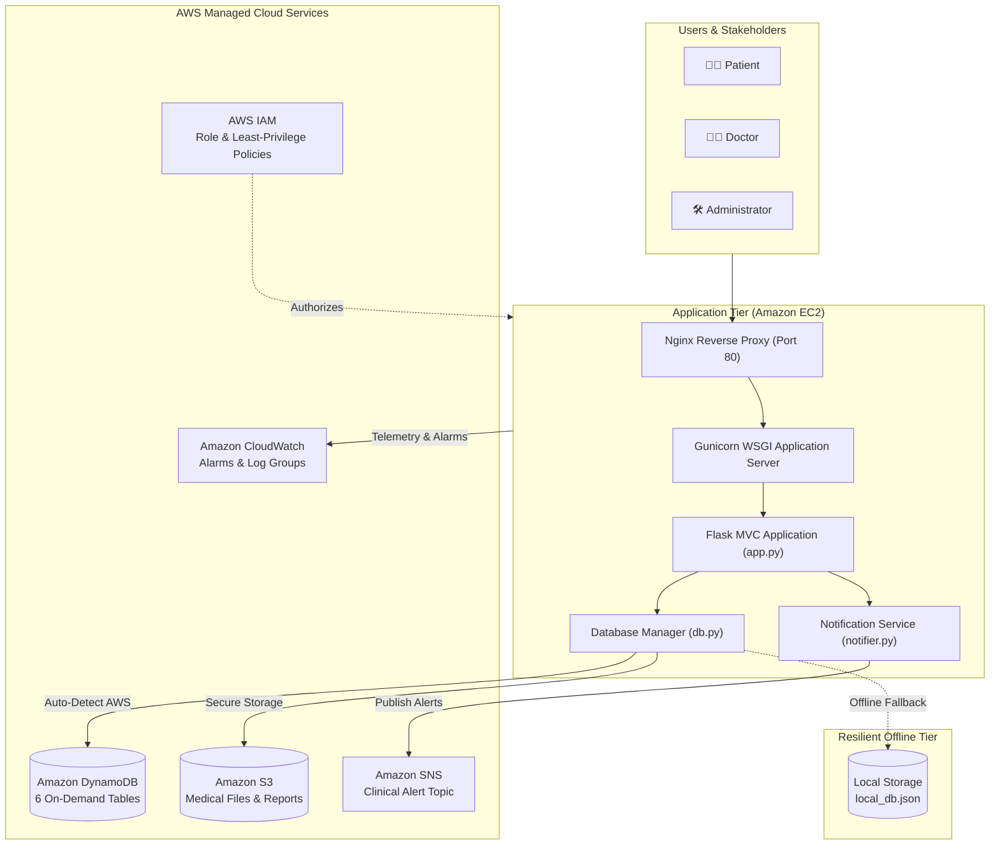
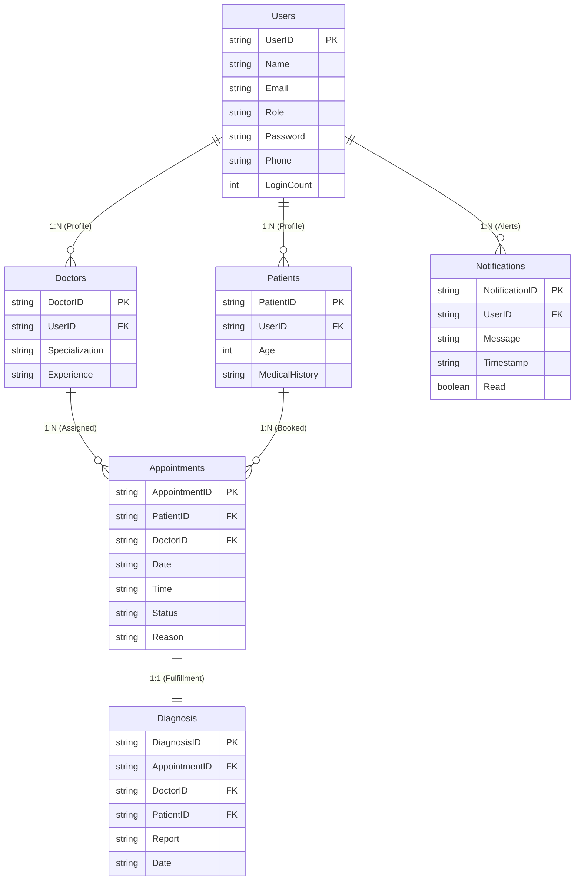

# MedTrack — Cloud-Based Patient Medical Record & Healthcare System

[](https://www.python.org/)
[](https://palletsprojects.com/p/flask/)
[-232F3E.svg?logo=amazon-aws)](https://aws.amazon.com/)
[](LICENSE)

MedTrack is an enterprise-grade, cloud-enabled healthcare management platform designed to streamline clinical workflows between **Patients**, **Doctors**, and **Administrators**. The system centralizes patient consultation booking, digital health profiles, diagnosis and prescription delivery, automated notifications, and cloud telemetry.

---

## 🔗 Live Deployments & Demo

- 🚀 **AWS EC2 Live Deployment**: [http://54.84.14.155:5000](http://54.84.14.155:5000)
- 🌐 **Cloud Mirror Demo**: [https://medtrack-34zi.onrender.com](https://medtrack-34zi.onrender.com)
- 🎥 **Full Walkthrough & Demo Video**: [Watch on Google Drive](https://drive.google.com/file/d/1DUro2Bkzsi8s-ga1oqmsVp43VjrhQXKE/view?usp=sharing)

---

## ☁️ Core AWS Cloud Capabilities

MedTrack is engineered around standard cloud architecture principles, implementing six primary AWS services:

| AWS Service | Architectural Role | Implementation |
|---|---|---|
| **Amazon EC2** | Compute & Web Application Hosting | Hosts the production Flask application with Gunicorn WSGI and Nginx reverse proxy. |
| **AWS IAM** | Role-Based Access Control & Security | `MedTrack_EC2_Role` enforces least-privilege security policies for compute and data access. |
| **Amazon DynamoDB** | Scalable NoSQL Data Persistence | 6 decoupled on-demand tables for users, doctors, patients, appointments, diagnoses, and alerts. |
| **Amazon S3** | Durable Cloud Object Storage | Secure storage for patient diagnostic records, medical file attachments, and prescription PDFs. |
| **Amazon SNS** | Cloud Notification Service | Pub/Sub topic dispatching instant appointment confirmations and clinical alerts via email/SMS. |
| **Amazon CloudWatch** | Cloud Monitoring & Observability | Telemetry collection, CPU utilization alarms, application performance logging, and health metrics. |
| **Infrastructure Automation** | Automated Provisioning & Bootstrap | Shell automation script (`medtrack_ec2_user_data.sh`) for unattended server configuration. |

---

## 🏛️ System Architecture

MedTrack features a **Smart Hybrid Data Layer** with auto-detection and graceful fallback:
- **Automatic AWS Cloud Detection**: When deployed on EC2 with an attached IAM role or configured AWS credentials, MedTrack directly interfaces with AWS DynamoDB, Amazon S3, and Amazon SNS.
- **Zero-Downtime Fallback**: If cloud connectivity is temporarily interrupted or during offline development, MedTrack automatically falls back to local persistent storage (`local_db.json`) with zero service interruption.



---

## 📊 Database Entity Model

The relational entity structure across Amazon DynamoDB tables:



---

## ✨ Key Features by Portal

### 👨‍💼 Patient Portal
- **Physician Directory & Booking**: Search licensed physicians by specialty, review qualifications, and book collision-free appointments.
- **Medical History & Profile**: Maintain detailed health metrics including age, past medical conditions, and emergency contact details.
- **Diagnosis & Prescriptions**: View formal physician diagnosis reports with itemized treatment regimens.
- **In-App & Email Notifications**: Real-time status alerts for appointments (`Scheduled`, `Completed`, `Cancelled`).

### 👩‍⚕️ Doctor Clinical Portal
- **Clinical Command Center**: Overview of daily consultations, pending patient requests, and scheduled visits.
- **Patient History Access**: Review patient consultation history and medical background prior to appointments.
- **Diagnostic Submission**: Issue comprehensive clinical reports and prescriptions; automatically marks visits as `Completed` and notifies the patient.

### 🛠️ Administrator & Monitoring Portal
- **Health Telemetry**: Real-time inspection via `/health` returning cloud connectivity, active storage engine, user counts, and system status.
- **Audit Logging**: User authentication tracking with automated `LoginCount` telemetry.

---

## 🔑 Pre-Seeded Demo Credentials

MedTrack is pre-seeded with sample profiles across all roles:

| Role | Email | Password | Details |
|---|---|---|---|
| **Patient** | `john.doe@gmail.com` | `Patient@123` | Patient Profile (Johnathan Doe) |
| **Patient** | `emily.watson@gmail.com` | `Patient@123` | Patient Profile (Emily Watson) |
| **Doctor** | `sarah.johnson@medtrack.com` | `Doctor@123` | Dr. Sarah Johnson (Cardiology) |
| **Doctor** | `michael.chen@medtrack.com` | `Doctor@123` | Dr. Michael Chen (Neurology) |
| **Admin** | `admin@medtrack.com` | `Admin@123` | System Administrator & Telemetry |

---

## 🚀 Installation & Local Execution

### 1. Prerequisites
- Python 3.10 or higher
- Git

### 2. Clone Repository & Setup Virtual Environment
```bash
git clone https://github.com/purva-yenpure/medtrack.git
cd medtrack

# Create and activate virtual environment
python -m venv venv

# On Linux/macOS:
source venv/bin/activate
# On Windows:
venv\Scripts\activate
```

### 3. Install Dependencies
```bash
pip install -r requirements.txt
```

### 4. Configure Environment
Copy the example environment template:
```bash
cp .env.example .env
```
*(MedTrack will run seamlessly in Local Storage mode out of the box if AWS credentials are not configured).*

### 5. Launch Application
```bash
python app.py
```
Access the application at:
- **Web Interface**: [http://127.0.0.1:5000](http://127.0.0.1:5000)

---

## 🧪 Automated Testing

MedTrack includes an automated end-to-end verification suite covering the complete application lifecycle:

```bash
python test_app.py
```

The test suite validates:
1. `test_01_health_check`: Verifies the `/health` API contract and active storage mode.
2. `test_02_login_and_login_count_increment`: Verifies authentication and audit telemetry.
3. `test_03_patient_appointment_booking`: Verifies collision-free consultation scheduling.
4. `test_04_search_appointments`: Verifies multi-parameter query filtering.
5. `test_05_doctor_submit_diagnosis`: Verifies clinical report submission and auto-completion.
6. `test_06_profile_update`: Verifies patient record updates.

---

## ☁️ AWS Cloud Provisioning & Deployment Guide

### Step 1: Provision Cloud DynamoDB Tables & SNS Topic
When connected to AWS:
```bash
python create_tables.py
```
This automatically provisions:
- 6 DynamoDB tables with on-demand billing (`PAY_PER_REQUEST`).
- Amazon SNS topic: `MedTrack_Healthcare_Alerts`.

### Step 2: IAM Security Configuration
Attach the IAM policy defined in [`aws_configs/medtrack_iam_policy.json`](aws_configs/medtrack_iam_policy.json) to your EC2 instance role (`MedTrack_EC2_Role`).

### Step 3: EC2 Deployment via Automation Script
Use [`aws_configs/medtrack_ec2_user_data.sh`](aws_configs/medtrack_ec2_user_data.sh) as the EC2 User Data script to automatically install Python, configure Gunicorn as a systemd service, and configure Nginx as a reverse proxy.

---

## 📂 Project Structure

```text
medtrack/
├── aws_configs/
│   ├── medtrack_ec2_user_data.sh    # EC2 bootstrap automation script
│   └── medtrack_iam_policy.json     # IAM least-privilege security policy
├── static/
│   ├── css/style.css                # Healthcare UI stylesheet
│   └── js/main.js                   # Client-side theme and dynamic forms
├── templates/
│   ├── base.html                    # Master layout template
│   ├── index.html                   # Landing page with physician search
│   ├── login.html                   # Role-based authentication
│   ├── register.html                # Dual-role account registration
│   ├── patient_dashboard.html       # Patient metrics and upcoming visits
│   ├── doctor_dashboard.html        # Physician consultation queue
│   ├── admin_dashboard.html         # System audit and metrics
│   ├── appointments.html            # Consultation management
│   ├── book_appointment.html       # Slot scheduling interface
│   ├── submit_diagnosis.html        # Clinical diagnosis submission
│   ├── medical_history.html         # Patient longitudinal record
│   ├── profile.html                 # User profile editor
│   ├── notifications.html           # In-app notification center
│   └── search.html                  # Multi-criteria appointment search
├── .env.example                     # Environment configuration template
├── app.py                           # Flask backend, routing, and controllers
├── config.py                        # Centralized application configuration
├── create_tables.py                 # DynamoDB and SNS automated provisioner
├── db.py                            # Hybrid data layer (DynamoDB & Local fallback)
├── notifier.py                      # Multi-channel notification engine (SNS & In-App)
├── requirements.txt                 # Project dependencies
├── test_app.py                      # End-to-end automated test suite
├── AWS_MIGRATION_GUIDE.md           # AWS cloud operations guide
└── README.md                        # Project documentation
```

---

## 📄 License
This project is licensed under the MIT License — see the [LICENSE](LICENSE) file for details.
